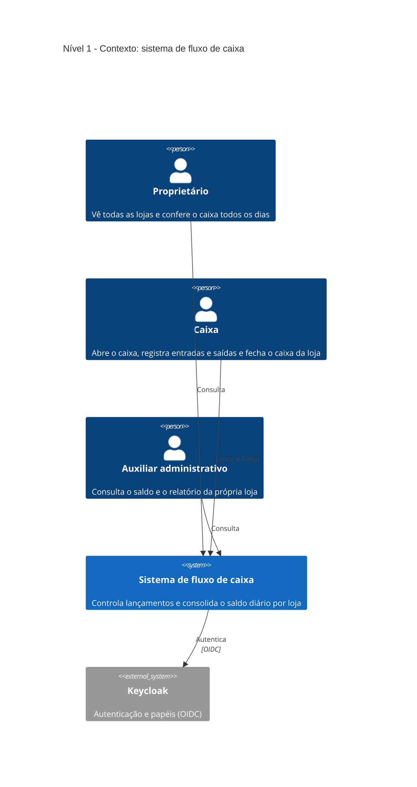
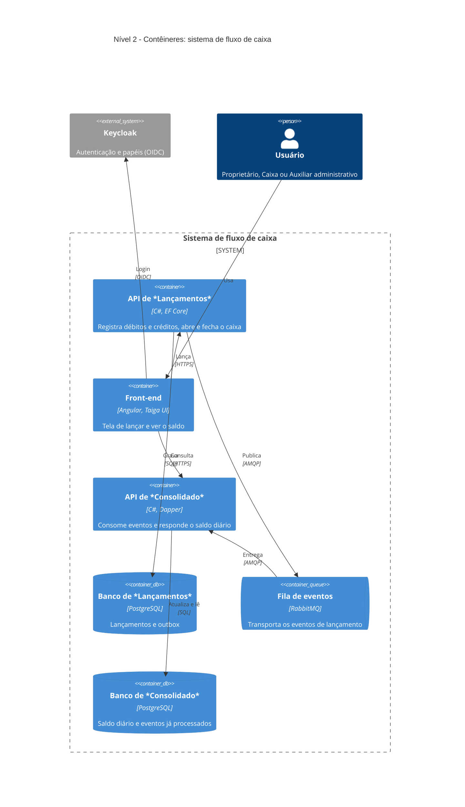

# Arquitetura do Sistema

* **Data:** 18/11/2026
* **Autores:** Leandro Fernandes

Este documento é o guia de referência da arquitetura do sistema de **Fluxo de Caixa**, tomando como exemplo o caso da **Fernandes Mecânica**. Nele detalhamos o contexto de negócio e os demais pontos que envolvem o projeto.

## Índice

1. [Visão geral](#1)
   - 1.1 [Escopo](#1_1)
2. [Contexto](#2)
   - 2.1 [Atores](#2_1)
   - 2.2 [Domínios](#2_2)
   - 2.3 [Considerações](#2_3)
3. [Requisitos](#3)
   - 3.1 [Requisitos funcionais](#3_1)
   - 3.2 [Requisitos não funcionais](#3_2)
4. [Arquitetura alvo](#4)
   - 4.1 [Contexto](#4_1)
   - 4.2 [Contêineres](#4_2)
   - 4.3 [Fluxo de um lançamento](#4_3)
   - 4.4 [Como a arquitetura atende os requisitos](#4_4)
5. [Decisões](#5)
6. [Segurança](#6)
7. [Qualidade e observabilidade](#7)
8. [Riscos e impactos](#8)
9. [Custos](#9)
10. [Transição](#10)
11. [Evoluções futuras](#11)

## 1. Visão geral

O comerciante precisa controlar seu fluxo de caixa diário, com lançamentos de débito e crédito, e consultar o saldo diário *Consolidado*.

O **Sistema de Fluxo de Caixa** está sendo pensado para atender a **Fernandes Mecânica**, com o intuito de substituir o processo que hoje é feito em planilhas, de maneira descentralizada, por um modelo SaaS multi-tenant que fará a unificação das informações das lojas.

A solução é dividida em dois serviços independentes. O serviço de *Lançamentos* registra cada débito e crédito e responde ao caixa na hora. A cada lançamento, ele avisa o outro serviço por meio de um evento. O serviço de *Consolidado* recebe esses eventos e mantém o saldo diário de cada loja já calculado, pronto para consulta. Se o *Consolidado* ficar fora do ar, os lançamentos continuam sendo aceitos e os eventos esperam na fila, e o saldo é atualizado quando o serviço voltar.

### 1.1 Escopo

* O que o sistema faz
   * Lançamento de entradas (créditos) e saídas (débitos) por loja
   * Emissão de relatório do saldo diário e dos lançamentos, *Consolidado* por loja e empresa
* O que o sistema **não faz**
   * Controle de estoque
   * Controle de ordens de serviço
   * Orçamentos e vendas de produtos
   * Emissão de nota fiscal

## 2. Contexto

### 2.1 Atores

| Ator | Função |
| --- | --- |
| **Proprietário** | Vê e confere o caixa de todas as lojas todos os dias, através do relatório *Consolidado* |
| **Auxiliar administrativo** | Vê e confere o caixa da loja em que trabalha, através do relatório *Consolidado* |
| **Caixa** | Opera o caixa da loja em que trabalha, registra as entradas e saídas e fecha o caixa no final do dia |

### 2.2 Domínios

| Domínio | Ações |
| --- | --- |
| *Lançamentos* | Abrir caixa, Registrar entrada, Registrar saída, Fechar caixa |
| *Consolidado* | Consolidar o saldo diário por loja, Consultar o saldo de uma loja, Consultar o saldo da empresa e Disponibilizar o relatório |
| Transversal | Controlar o acesso por papel e por loja |

### 2.3 Considerações

* O saldo diário é por loja: o proprietário vê o de cada loja e o total das três.
* Os dados pertencem à empresa, e cada loja é uma divisão dela. O acesso é controlado por loja: o auxiliar administrativo e o caixa veem somente a própria loja.
* Cada loja tem um caixa.
* Ao fechar o caixa, o dia é encerrado e o proprietário pode ver o fechamento através do *Consolidado*.

## 3. Requisitos

### 3.1 Requisitos funcionais

| Código | Domínio | Descrição |
| --- | --- | --- |
| RF01 | *Lançamentos* | Abrir o caixa da loja no início do dia. Cada loja tem um caixa aberto por dia. |
| RF02 | *Lançamentos* | Registrar uma *entrada* com valor, data e descrição, somente com o caixa aberto. *Lançamentos* são imutáveis. |
| RF03 | *Lançamentos* | Registrar uma *saída* com valor, data e descrição, somente com o caixa aberto. *Lançamentos* são imutáveis. |
| RF04 | *Lançamentos* | Fechar o caixa. O dia da loja é encerrado e não aceita mais lançamentos. |
| RF05 | *Consolidado* | Atualizar o saldo diário da loja a cada lançamento registrado. Saldo do dia = créditos − débitos daquele dia, por loja. |
| RF06 | *Consolidado* | Consultar o saldo diário de uma loja. |
| RF07 | *Consolidado* | Consultar o saldo diário da empresa, somando as lojas. Saldo da empresa = soma dos saldos do dia de cada loja. |
| RF08 | *Consolidado* | Disponibilizar o relatório do dia, com lançamentos e saldo, por loja e para a empresa. |
| RF09 | Transversal | Autenticar o usuário e identificar seu papel e sua loja. |
| RF10 | Transversal | Restringir o acesso por loja: caixa e auxiliar veem só a própria, o proprietário vê todas. |
| RF11 | Transversal | Restringir as ações por papel: só o caixa lança, abre e fecha; só o proprietário valida; o auxiliar só consulta. |

### 3.2 Requisitos não funcionais

| Código | Requisito | Meta | Como verificar |
| --- | --- | --- | --- |
| RNF01 | Isolamento de falha | Com o *Consolidado* parado, o *Lançamentos* aceita 100% dos lançamentos válidos. | Derrubar o *Consolidado*, enviar lançamentos e conferir que nenhum falhou. |
| RNF02 | Desempenho do *Consolidado* | 50 req/s durante 5 minutos, com no máximo 5% de falha e resposta em até 500 ms. | Teste de carga. |
| RNF03 | Atraso do saldo | Até 5 segundos depois do lançamento. Depois de uma parada, até 5 minutos após o retorno. | Medir o tempo entre o lançamento e o saldo atualizado. |
| RNF04 | Disponibilidade | *Lançamentos* 99,5%. *Consolidado* 99%. | Monitoramento de disponibilidade. |
| RNF05 | Durabilidade e sem duplicidade | Nenhum lançamento aceito se perde. Um evento repetido não altera o saldo duas vezes. | Teste de integração. |

## 4. Arquitetura alvo

A arquitetura é descrita no modelo C4, em dois níveis: o contexto (quem usa o sistema e com o que ele conversa) e os contêineres (as peças que rodam). Nos diagramas, o azul é o que construímos e o cinza é o que é externo.

### 4.1 Contexto

Os três atores usam o sistema conforme o seu papel (seção 2.1). A autenticação e os papéis ficam fora dele, em um provedor de identidade (Keycloak), o que mantém o sistema focado no negócio.

### 4.2 Contêineres

| Contêiner | Responsabilidade |
| --- | --- |
| Front-end | Tela de lançar e de ver o saldo. Obtém o token no Keycloak e chama as duas APIs. |
| API de *Lançamentos* | Abre e fecha o caixa e registra entradas e saídas. Grava o lançamento e o evento no mesmo banco, na mesma transação (outbox). |
| Banco de *Lançamentos* | Guarda os lançamentos e os eventos ainda não publicados. |
| Fila de eventos | Transporta os eventos de lançamento. Quem publica não espera quem consome. |
| API de *Consolidado* | Consome os eventos, ignora os repetidos, atualiza o saldo diário e responde às consultas e ao relatório. |
| Banco de *Consolidado* | Guarda o saldo diário por loja e os eventos já processados. |

Cada serviço tem o seu próprio banco, e os dois só se comunicam por eventos. Os dados são da empresa, e o acesso é limitado por papel e por loja (detalhes na seção 6).

### 4.3 Fluxo de um lançamento

1. O caixa registra uma entrada ou saída no front-end, que chama a API de *Lançamentos*.
2. A API grava o lançamento e o evento correspondente no Banco de *Lançamentos*, em uma única transação, e responde ao caixa.
3. Em segundo plano, o evento é publicado na fila.
4. A API de *Consolidado* recebe o evento e verifica se ele já foi processado. Se não foi, atualiza o saldo do dia da loja e registra o evento como processado.
5. O proprietário e o auxiliar consultam o saldo já calculado, sem somar lançamentos na hora.

### 4.4 Como a arquitetura atende os requisitos

| Requisito | Como é atendido |
| --- | --- |
| RNF01 Isolamento de falha | O *Lançamentos* só grava no próprio banco. Se o *Consolidado* parar, os eventos esperam na fila. |
| RNF02 Desempenho do *Consolidado* | O saldo já está calculado, e a leitura não soma lançamentos. A API de *Consolidado* pode rodar em várias instâncias. |
| RNF03 Atraso do saldo | A atualização é assíncrona e contínua. Depois de uma parada, o consumidor esvazia a fila acumulada. |
| RNF04 Disponibilidade | Serviços independentes: a queda de um não derruba o outro. |
| RNF05 Durabilidade e sem duplicidade | O outbox garante que o evento nasce junto com o lançamento. O registro dos eventos já processados impede contar duas vezes. |

## 5. Decisões

Para a escolha da arquitetura foram tomadas algumas decisões que estão registradas nos ADRs a seguir. Cada uma é baseada nos [requisitos não funcionais](#3_2) da solução e registra o contexto, a escolha, a alternativa descartada e as consequências.

| ADR | Decisão |
| --- | --- |
| [001](adr/001-dois-servicos.md) | Separar *Lançamentos* e *Consolidado* em dois serviços |
| [002](adr/002-saldo-em-tabela-propria.md) | Saldo diário em tabela própria, atualizada por eventos |
| [003](adr/003-rabbitmq-outbox.md) | RabbitMQ com outbox e consumidor sem duplicidade |
| [004](adr/004-cqrs-leve.md) | CQRS leve, com EF Core na escrita e Dapper na leitura |
| [005](adr/005-acesso-por-empresa-e-loja.md) | Acesso por empresa e loja com Keycloak e RLS no PostgreSQL |

## 6. Segurança

* **Autenticação e autorização:** toda chamada exige token do Keycloak (OIDC). A API confere assinatura, validade e audiência. O papel define a ação (RF11) e o grupo define a loja (RF10).
* **Isolamento dos dados:** RLS por loja no banco. Sem a loja informada, nenhuma linha é devolvida (ADR 005).
* **Transporte e segredos:** HTTPS nas APIs. Segredos fora do repositório, com apenas um `.env.example` de valores fictícios.
* **Mensageria:** cada serviço tem seu usuário no RabbitMQ, com permissão mínima: o *Lançamentos* só publica e o *Consolidado* só consome.

## 7. Qualidade e observabilidade

* **Testes:** unitários (regra do saldo diário e evento repetido), de integração com PostgreSQL e RabbitMQ em contêineres, de arquitetura (xUnit), de isolamento do RLS, de resiliência (derrubar o *Consolidado*, RNF01) e de carga (50 req/s por 5 minutos, RNF02).
* **Execução:** os testes unitários, de arquitetura, de isolamento e de integração rodam a cada pull request em GitHub Actions. Os testes de resiliência e de carga rodam sob demanda.
* **Observabilidade:** as APIs são instrumentadas com OpenTelemetry (métricas, traces e logs). Na demonstração, os dados vão para o Aspire Dashboard, que sobe junto no `docker compose`. Em produção, a proposta é Prometheus e Grafana, com alerta quando a fila acumula por mais de 1 minuto. Um trace acompanha o lançamento até o saldo atualizado.

## 8. Riscos e impactos

| Risco | Mitigação |
| --- | --- |
| RabbitMQ fora do ar | O outbox guarda os eventos e reenvia quando ele volta |
| Evento repetido | O *Consolidado* registra os eventos já processados (RNF05) |
| Mensagem com erro repetida | Fila de erros e alerta |
| Pico acima de 50 req/s | Saldo já calculado e várias instâncias |
| Keycloak fora do ar | Tokens de curta duração. Sessões ativas continuam |
| Lançamento errado, sem edição | Fora do escopo. Evolução: lançamento de ajuste |

## 9. Custos

- **Premissas:** 3 lojas, cerca de 1.000 lançamentos por dia (a validar no teste de carga, RNF02).
- **Licenças:** sem custo (tudo open source).
- **Infraestrutura:** VPS Hostinger, plano de 24 meses.

| Cenário | Servidores | 24 meses | Após renovação |
| --- | --- | --- | --- |
| Produção inicial | 1 × KVM 4 (aplicações)   1 × KVM 2 (bancos e RabbitMQ) | R$ 102,98 | R$ 227,98 |
| Alta disponibilidade | 2 × KVM 4   3 × KVM 2   1 × KVM 1 (balanceador Nginx) | R$ 278,94 | R$ 593,94 |

Fonte: [https://www.hostinger.com/br/precos/vps-hosting#plan-selector](https://www.hostinger.com/br/precos/vps-hosting#plan-selector), consultada em 18/11/2026.

## 10. Transição

Hoje o caixa é controlado em planilhas. A migração é gradual:

1. **Preparação:** cadastro das lojas e dos usuários, e treinamento.
2. **Convivência:** uma loja piloto (Rio Verde) usa o sistema e a planilha em paralelo, e o proprietário compara os saldos todo dia. Como a planilha continua completa, voltar a ela não perde nada.
3. **Corte por loja:** com os saldos batendo, a loja passa a usar só o sistema, e depois seguem as outras duas.
4. **Encerramento:** as planilhas são arquivadas.

É a lógica de migrações incrementais que já conduzi em outros sistemas: conviver com o antigo, comparar e só então desligar.

## 11. Evoluções futuras

* Lançamento de ajuste para corrigir erros, e reabertura do caixa
* Saldo acumulado entre os dias
* CQRS completo com Event Sourcing
* Cache nas consultas do *Consolidado*
* Atualização em tempo real da tela de saldo
* Bancos em servidores separados e alta disponibilidade